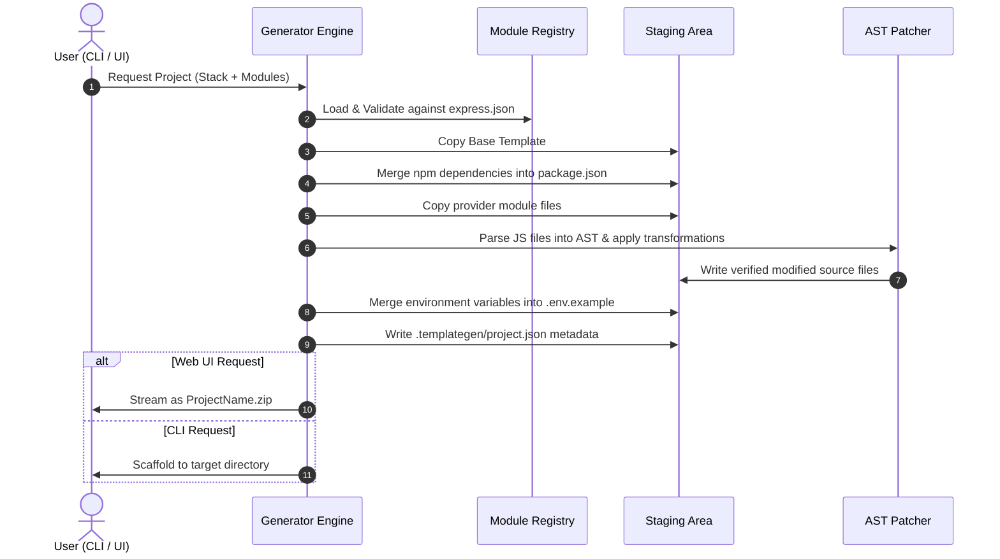

# TemplateGen

> An AST-powered modular project scaffolding and code integration engine with both a CLI and an interactive Web UI.

[](#status)
[](#license)

---

## Overview

TemplateGen is an extensible project generator designed to eliminate boilerplate setup without relying on brittle string-matching patches or bloated monolithic starters.

- **Why it exists:** Most starter templates either provide bare-bones skeletons requiring hours of repetitive wiring (databases, sockets, configurations), or all-in-one kitchen-sink templates that are difficult to prune. Existing generator tools often use fragile regex or string replacement to patch code, which easily breaks across formatting changes.
- **What problem it solves:** TemplateGen uses an **AST (Abstract Syntax Tree)** transformation pipeline to safely insert imports, object properties, switch cases, and lifecycle calls directly into source files without altering unrelated code or corrupting formatting.
- **Who it is intended for:** Developers and teams who want consistent, production-ready project scaffolding with opt-in module configurations (Database, Sockets, Auth, etc.) delivered via both an interactive CLI and a modern web interface.

---

## What It Is

TemplateGen is a registry-driven project generator. Rather than hardcoding generation logic for specific technologies, it separates generation into:

1. **Base Templates:** Clean, minimal application starters that can boot and run independently without requiring any optional modules.
2. **Modular Registry:** A centralized specification (`knowledgebase/registry/...`) declaring available modules, providers (e.g., MongoDB via Mongoose, WebSockets via Socket.IO), runtime file mappings, npm dependencies, and AST transformations.
3. **AST Transformation Engine:** An Acorn-based syntax tree modifier that safely injects imports, object properties, switch cases, and function call statements into target files.
4. **Unified Delivery:** Available as both a command-line tool (`templategen`) and a dogfooded Express + Cyberpunk web UI that allows configuring and downloading scaffolded projects as `.zip` archives.

---

## Demo

**Live Demo:** `http://localhost:3000` *(Run locally via `cd server && npm start`)*  
**Repository:** `https://github.com/STRO09/TemplateGenerator`

---

## Screenshots & Media

### Architecture Diagram

```mermaid
flowchart TD
    subgraph Interfaces
        CLI[templategen CLI]
        UI[Web UI (client/)]
    end

    subgraph Backend [Server (server/)]
        API[Express API (/api/generate)]
        GenService[Generator Service]
        ZipUtil[PKZIP Streamer]
    end

    subgraph Core Engine [TemplateGen Core (cli/)]
        Patcher[AST Patcher & Env Merger]
        AST[Acorn AST Transformer]
        FileCopier[Module File Copier]
        DepMerger[Dependency Merger]
        Meta[Project Metadata Manager]
    end

    subgraph Knowledgebase [Knowledgebase (knowledgebase/)]
        Reg[Technology Registry (express.json)]
        BaseTpl[Base Templates (Express Starter)]
        ModTpl[Reusable Modules (db, socket, ...)]
    end

    CLI --> Core Engine
    UI --> API
    API --> GenService
    GenService --> Core Engine
    GenService --> ZipUtil
    Core Engine --> Knowledgebase
    ZipUtil -->|Download .zip| UI
```

---

## Tech Stack

| Category | Technology |
| --- | --- |
| Runtime | Node.js (v18+) |
| Language | JavaScript (ES Modules) |
| Web Framework | Express 5 |
| AST Engine | Acorn (ECMAScript parser) |
| Compression | Native Node.js `zlib` (Deflate / PKZIP) |
| Frontend UI | Vanilla HTML5, Modern CSS3, Lucide Icons |
| Metrics & Monitoring | `prom-client` (Prometheus metrics) |
| Configuration | Centralized `env.js` with `dotenv` fallbacks |

---

## Features

### Core Features

- **Registry as Single Source of Truth:** All module options, npm dependencies, file mappings, and AST injection instructions are defined declaratively in registry files (such as `knowledgebase/registry/server/node/express.json`).
- **AST-Based Code Transformations:** Replaces fragile text replacement with AST parsing via Acorn. Safely applies:
  - `add-import`: Injects named/default ES imports and prevents duplicate bindings.
  - `add-object-properties`: Appends key-value pairs to existing config objects (e.g., `env.js`).
  - `add-switch-case`: Inserts switch cases before default handlers (e.g., database driver routing).
  - `insert-before-call`: Inserts asynchronous init/listener code right before target function calls (e.g., `server.listen` or `http.createServer`).
- **Conflict & Error Safety:** Validates all destination paths and AST modifications before writing any file to disk. Operates in isolated staging with atomic cleanup on failure.
- **Dependency & Environment Merging:** Injects provider-specific npm dependencies directly into `package.json` and updates `.env.example` without overwriting custom settings.

### Scaffolding & Web UI

- **Interactive Cyberpunk UI:** Custom glitch and neon aesthetics with responsive mobile/desktop layouts.
- **Live vs. Roadmap Indicators:** Real-time feedback showing implemented modules (`Socket.IO`, `Mongoose`) while clearly marking in-progress features as "Soon".
- **Zero-Install Browser ZIP Generation:** Generates the complete, patched codebase in memory and streams it as a standard `.zip` download straight to your browser's Downloads folder.
- **CLI Commands:** Standard terminal workflow via `templategen create` and `templategen add`.

---

## Architecture

### Architecture Overview

TemplateGen follows a strict separation of concerns across four key layers:

1. **Registry & Knowledgebase:** Defines tech capabilities (`availableTech.json`), provider configurations (`express.json`), and raw module templates.
2. **Transformation Pipeline:** Translates declarative instructions into AST nodes and safe filesystem copy operations.
3. **Execution Interface:** Provides interactive CLI prompts (`cli/`) and REST endpoints (`server/`).
4. **Dogfooded Architecture:** The web backend (`server/`) is itself a TemplateGen Express scaffolded application, showcasing and utilizing the exact template it produces.

### Generation Flow



---

## Project Structure

```text
TemplateGenerator/
├── cli/                        # CLI command runner and AST patching engine
│   ├── cli.js                  # Main CLI executable entry point
│   ├── patcher.js              # Coordinates AST transformations and env merging
│   ├── commands/               # CLI commands: create, add
│   ├── lib/                    # Core modules: ast-transformer, dependencies, module-files, etc.
│   └── tests/                  # AST transformation unit tests
├── client/                     # Web UI frontend
│   ├── index.html              # Cyberpunk UI layout, glitch text, and generator modal
│   └── styles.css              # Design tokens, layout, and glitch animation keyframes
├── server/                     # Dogfooded Express backend serving the UI and Generator API
│   ├── src/
│   │   ├── server.js           # Server startup and HTTP listener
│   │   ├── app.js              # Express app setup and static client serving
│   │   ├── routes/             # API routes (/api/tech, /api/generate, /api/health)
│   │   ├── controllers/        # Generator and Health controllers
│   │   ├── services/           # Generator service wrapping the CLI patching engine
│   │   ├── utils/              # PKZIP generator, ApiError, logger, metrics
│   │   └── config/             # Centralized environment configuration (env.js)
│   └── package.json            # Server package manifest
├── knowledgebase/              # Source of truth for templates and integrations
│   ├── availableTech.json      # Supported languages, frameworks, and implementation status
│   ├── registry/               # Declarative module specifications (e.g. server/node/express.json)
│   └── templates/              # Base starter templates and reusable modules
├── PROJECT_DESC.MD             # Project architecture and component reference
├── .gitignore                  # Git ignore rules for dependencies, env, and build artifacts
└── README.md                   # Project documentation
```

---

## Getting Started

### Prerequisites

- **Node.js**: v18.0.0 or higher
- **npm**: v9.0.0 or higher

### Running the Web UI

1. Enter the server directory and install dependencies:
   ```bash
   cd server
   npm install
   ```

2. Start the server:
   ```bash
   npm start
   ```

3. Open your browser at:
   ```text
   http://localhost:3000
   ```

4. Choose your project name, select optional modules (Sockets, Database), and click **Generate & Download ZIP**.

---

### Using the CLI

1. Link the CLI globally:
   ```bash
   cd cli
   npm install
   npm link
   ```

2. Create a new project:
   ```bash
   templategen create my-app -server node --servername server --apiframework express
   ```

3. Add modules to an existing TemplateGen project:
   ```bash
   cd my-app
   templategen add
   ```
